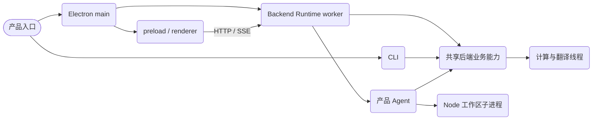

# LinguaGacha 架构设计

LinguaGacha 让 GUI、CLI 与产品 Agent 共用后端业务能力，工程事实由同一套写入流程维护。

进程隔离用于保持桌面响应，并让计算、取消和资源释放有各自的执行边界。

## 🧭 专题入口

|需要理解的设计意图|归宿|
|---|---|
|进程隔离、依赖方向、跨层不变量与资源生命周期|本文|
|CLI 的临时工程、设置继承与机器输出|[CLI](CLI.md)|
|工程一致性、任务恢复、文件存储、原生游戏、PDF 与网络策略|[BACKEND](BACKEND.md)|
|产品 Agent 的会话、工作材料、授权与运行环境|[AGENT_RUNTIME](AGENT_RUNTIME.md)|
|前端状态寿命、交互恢复与宿主接入|[FRONTEND](FRONTEND.md)|
|源码定位、开发命令与验证选择|[WORKFLOW](WORKFLOW.md)|

文档收录与维护规则见 [AGENTS.md](../AGENTS.md)。

## 🧩 进程隔离

GUI 将完整后端放入独立 `worker_thread`，使业务执行与 Electron 窗口生命周期分开。

- renderer 通过本机 HTTP / SSE 消费后端。
- main 与后端通过线程消息处理启动、关闭和宿主回调。
- CLI 在当前进程中创建共享后端，按单次任务释放服务。

GUI 与 CLI 在各自环境中实例化共享后端，让翻译、工程写入和译文生成沿用同一套业务语义。GUI 的 `GuiBackendBootstrap` 额外装配 Agent 与 Gateway。

资源路径由入口显式注入：安装根、只读内置资源根和工作区运行目录随应用版本确定。这样，工作目录变化不会改变线程或子进程使用的资源。

正式运行的执行策略有两条约束：

- GUI 后端与重型计算使用独立线程。`in_process` 供测试或源码运行显式选择。
- 后端 worker 意外退出会结束应用。继续运行需要重新建立工程会话、运行占用和所有在途操作的一致状态。

## 🔗 依赖方向

共享能力按依赖范围放置：

- `src/domain` 与 `src/shared` 保存领域值和纯规则，让后端、renderer 与工作区使用相同语义。
- `src/native` 处理平台 IO，使平台差异集中在文件与宿主边界。
- 界面通过公开协议消费业务能力，依赖方向由 `buildtools/check/` 校验。

后端装配分为基础资源和业务服务：

- `BackendResources` 管理基础资源。
- `BackendServices` 组织业务服务，供 CLI 和产品 Agent 复用。
- Gateway 将已装配的服务适配为公开协议。

## 📐 跨层不变量

### 真实文件系统

业务文件系统只处理真实磁盘对象。容器内容由显式解析流程处理。业务直接读取的版本资源部署为真实文件，并由入口注入路径。

### 已提交事实优先

写入可能先于回包、事件或 SDK 回执完成持久化，这些消息也可能丢失或乱序到达。

- 恢复先核对已提交的工程事实和持久化回执，再决定是否处理原请求。
- 调用方重读当前事实，避免重复执行已经完成的写入。

### 占用持续到收尾

取消只是请求收尾。运行占用和宿主资源在线程、子进程、宿主请求、回滚、清理和文件句柄全部收尾后才释放，使新操作不会与仍在写入的旧操作争用工程、目录或资源。

### 执行内配置固定

设置和模型配置可以随时修改。一次执行在开始时采用配置快照，同一批请求、重试和工具循环共用该快照，修改由后续执行采用。

### 身份隔离迟到结果

工程会话、执行实例和输入尝试各有身份。迟到的回包、事件和回执先核对身份，不属于当前身份的结果不能改变新会话或新执行。

## ⏳ 关闭与宿主操作

关闭沿依赖关系逆序进行：

1. 停止受理并取消在途操作。
2. 等待使用者收尾。
3. 释放业务服务和基础资源。

单项清理失败后仍继续后续释放，并保留错误，避免遗留仍在运行的下层资源。

### Chromium 宿主

Chromium 启动语言与界面的 `app_language` 设置各自独立。覆盖安装可能残留旧版语言资源，因此产品入口须在 Chromium 加载资源前将启动语言限定为随包支持的语言。

图片编解码和 HTML 打印需要 Chromium，由 main 持有隐藏窗口。

- 后端决定业务策略并写入文件。
- 宿主执行图像或打印操作。
- 打印文档使用内嵌资源，并禁用脚本和外部访问，限制生成内容的资源访问范围。

### 取消与交付

图片和打印按 [占用持续到收尾](#占用持续到收尾) 交付：宿主回包确认原生资源已释放后，后端才释放 PDF 计算线程或 Agent 子进程的运行占用。取消原因由后端原始信号保留。

其它原生操作取消后结束调用方等待，并按 [身份隔离迟到结果](#身份隔离迟到结果) 丢弃迟到回包。

### Windows 应用更新

更新按顺序执行：

1. 等待页面保存。
2. 准备更新器。
3. 关闭 Backend Runtime 与 PDF 宿主。
4. 启动 `win-berserker`。

关闭完成后才覆盖安装文件，避免覆盖仍被使用的资源。

失败处理分为两个阶段：

- 准备失败：应用仍可继续使用。
- 进入收尾后的关闭或启动失败：原生错误框报告后结束应用。

安装采用直接覆盖，部分失败需要手动覆盖完整发行包恢复。更新日志与平台验证见 [WORKFLOW](WORKFLOW.md)。
